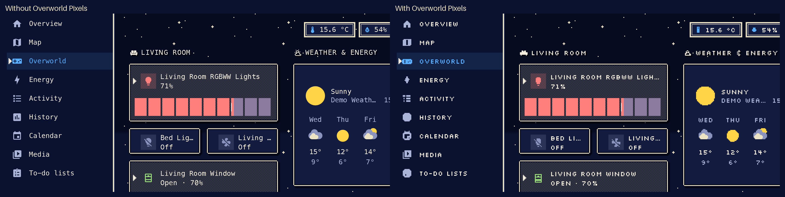
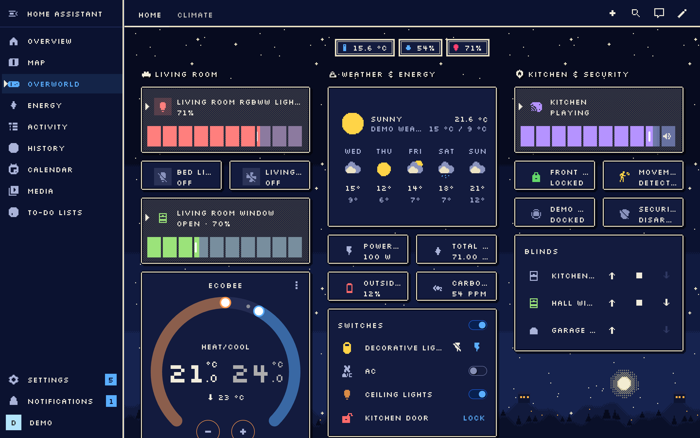

# Overworld Pixels

[](https://my.home-assistant.io/redirect/marketplace_repository/?owner=wsclx&repository=overworld-pixels&category=plugin)

A small frontend module for Home Assistant that redraws icons as pixel art and brings a pixel font. It is the companion of the [Overworld](https://github.com/wsclx/overworld-theme) theme and only does something while a theme switches it on.





## What it does

- **Pixel icons.** Every Material Design icon in the frontend and the weather icons of the weather forecast card are redrawn at runtime on a coarse grid. One art pixel is the same size everywhere (2 CSS pixels by default): a 24 px icon becomes a 12×12 sprite.
- **Pixel font.** It registers the font [Silkscreen](https://github.com/googlefonts/silkscreen) under the name `Overworld Pixel`. The font is embedded in the module, nothing is downloaded from the internet.
- **Only when asked.** Nothing changes unless the active theme sets `overworld-pixels: "on"`. Switch to another theme and the original icons come back.

## Requirements

- Home Assistant. Tested with Home Assistant 2026.11.2 (November 2026) in Chrome.
- A theme that switches the module on, for example [Overworld](https://github.com/wsclx/overworld-theme), which also sets the pixel font.

## Installation

### Marketplace (HACS)

1. Open **Settings → Marketplace** (or HACS on older versions).
2. Search for **Overworld Pixels** (category Dashboard) and download it. The Marketplace adds it as a dashboard resource.
3. Reload the page.

Dashboard resources load when a dashboard opens. To have pixel icons on settings pages right after a reload as well, load the module as a frontend module instead:

```yaml
frontend:
  extra_module_url:
    - /local/community/overworld-pixels/overworld-pixels.js
```

### Manual

1. Copy `overworld-pixels.js` into `www/overworld-pixels/` inside your configuration folder.
2. Add it under `extra_module_url` as above, with the path `/local/overworld-pixels/overworld-pixels.js`, and restart Home Assistant.

## Use it with your own theme

Add these variables to any theme:

```yaml
overworld-pixels: "on"          # switch the module on for this theme
overworld-pixel-size: "2"       # art pixel size in CSS pixels
ha-font-family-body: "'Overworld Pixel', ui-monospace, monospace"
ha-font-family-heading: "'Overworld Pixel', ui-monospace, monospace"
ha-font-size-m: "16px"          # the pixel font is crisp at 16, 24, 32 … px
```

## Known limits

- The icons are redrawn automatically, not drawn by hand. Icons with very fine inner lines lose detail; the threshold is a compromise between filled inner lines and lost thin lines.
- Toggle switches, the thermostat dial and charts are not icons and keep their smooth shapes.
- The module hooks into internal elements of the frontend (`ha-svg-icon`, the weather forecast card). A frontend update can change them; then icons simply stay smooth.
- The pixel font draws lowercase letters as capitals. It is wide, so long names are shortened earlier.

## Contributing

Issues and pull requests are welcome. Please include your Home Assistant version, the module version (shown in the browser console), browser and a screenshot.

## License

The code is under the [MIT License](LICENSE). The embedded font Silkscreen is © The Silkscreen Project Authors and licensed under the [SIL Open Font License 1.1](FONT-LICENSE.txt).

This is a community project. It is not affiliated with or endorsed by Home Assistant or the Open Home Foundation.
